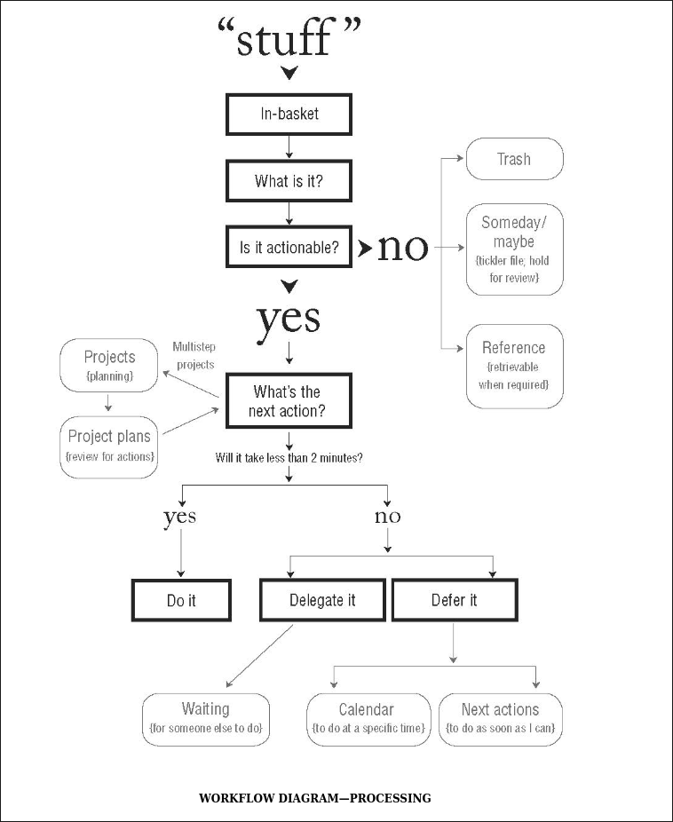

+++
date = '2026-10-18T21:57:43+08:00'
draft = true
title = 'GTD_note1'
+++

# GTD Note 1

## 核心矛盾

- Open Loop

原文:

Anything that does not belong where it is, the way it is, is an "open loop", which will be pulling on your attention if it's not appropriately managed.

也就是说 Open Loop 的核心在于**抢占不属于它的注意力和其他资源**. 进而导致资源没有办法顺利分配到现在的主要工作上， 最终使得效率低下

作者认为 Open Loop 对于人的工作效率影响非常大，对于对于如何找到并尽可能的减少 Open Loop 做出了探讨

---

- Stuff

原文:

Here's how I define "stuff": anything you have allowed into your psychological or physical world that doesn't belong where it is, but for which you haven't get determined what, exactly, it means to you, with the desired outcome and the next action step.

这里的 Stuff 的核心在于**悬置的状态**, 也就是它没有办法很好的指导真正的实践， 而只是作为一种模糊的想法

作者要做的就是将 Stuff 进行过滤， 转化， 最终成为 actions, projects, and usable information

---

- Project

原文:

I define a project as any desired result that can accomplished within a year that requires more than one step.

Project 的中文是项目， 作者这里做出两点限定， 第一是可以在一年之内完成， 第二是需要多步完成。 后续的 Plan 模块就是对于如何高效地完成一个 project 给出的解决方案

作者有一个非常重要的洞见就是: 你没有办法 "做一个 project" 你能做的只有 通过一个又一个的 action 来接近最终 project 所期待的状态.

Project 只是我们认为设立的一个终点线，它不是实践本身

原文:

You don't actually do a project; you can only do action steps related to it. When enough of the right actions steps have been taken, some situation will have been created that matches your initial picture of the outcome closely enough that you can call it "done". The list of projects is the complication of finish lines we put before us to keep our next actions moving on all tracks appropriately.

---

- Action

And the way to go that as we've seen, is not by managing time, managing information, managing priorities. After all:

- you don't manage five minutes and wind up with six;
- you don't manage information overload--otherwise you'd walk into a library and die, or the first time you connected to the web, you'd blow up;
- you don't manage priorities--you have them.

Instead, the key to managing all of your stuff is managing your actions.

作者在这里对于 时间， 信息， 优先级的管理进行了揭露。

我们并不是在真正的管理时间， 因为我们没有办法改变时间， 而只能改变在什么时间做什么事情， 所以它的本质应该是 管理 action 如何在固定的时间当中编排。

我们无法管理信息， 因为信息的体量是人类没有办法真正管理的， 如果我们真的尝试处理无边无际的信息， 我们进入图书馆就会 "死掉", 一上网就会 "爆炸" (这里的黑色幽默我也不是很懂， 可能就是希望说明没有办法处理海量的信息吧)

我们无法管理优先级， 因为优先级是本来就存在的， 我们要做的是把它们分辨出来进而在行动中赋予优先级对应的权重

---

- summary

所以作者在这本书当中真正希望做的就是

1. 对于我们脑中的想法进行各种操作， 进而得到有价值的内容并且将这些东西赶出大脑， 让大脑真正做有价值的事情。
2. 对于如何行动， 如何定义和完成一个 project, 并获得稳定的掌控感， 减少压力等给出解决方案

---

## Five Steps

对于如何对付脑中的各种想法， 作者给出了 五步解决法

原文:

We (1) **capture** what has our attention; (2) **clarify** what each items means and what to do about it; (3) **organize** the results, which presents the options we (4) **reflect** on, which we then choose to (5) **engage** with

也就是

- capture
- clarify
- organize
- reflect
- engage

接下来进行核心的解释

### Capture

Capture 就是要捕获占据我们注意力的东西， 将它们记下来听候发落。 这一步步进行任何的判断， 如果有什么想法或者东西占据了注意力， 就记录下来。

它的关键在于帮助我们解放大脑, 作者认为当我们拥有 "外挂的记忆" 和 "可信的外部系统" 来提醒我们这些东西尚未完成， 我们的大脑就会先放过它们， 进而解放注意力， 专注于真正应该做的事情

对于一些突然冒出来的新奇想法， 可能也有价值， 所以作者鼓励捕获**任何东西**, 只要它占据了注意力。

但是一般来说， 占据注意力的东西都是一些 *incomplete* 也就是想做但是还没做的事情。

每当有什么新的想法在不该出现的时候冒出来，我们就将它加入到 `capture inbox` 里面， 后续进行处理。

但是必须注意， 只捕获这些想法远远不够， 我们必须有强大的 "下游" 处理器来处理这些堆积的想法. 而接下来的步骤解决的就是这个问题

> [!NOTE]
> 如果你希望在多设备记录快速记录并且方便的进行查看和过滤
> 并且你还有一点技术或者会使用 AI 的话， 我推荐部署 [memos](https://usememos.com/)

### Clarify

Clarify 是非常关键的一步， 它是一种信息的过滤和路由(原谅我使用这种比较专业的词汇)。 它的作用就是根据这个 Stuff 的性质， 来将它们进行初步的筛选和分类， 让我们真正知道 **这些想法对于我们意味着什么， 我们应该使用什么态度和投入多少资源在这个想法上**

下面是作者给出的图

第一个过滤器就是

**它是否可行动?**

如果不可以行动， 这个想法会进入到右边的 No 的范围， 最终的归宿有三个

- 垃圾
- 或许有一天会做
- 成为有时候要引用的信息

而如果可以行动， 来到第二个过滤器

**下一步是什么?**

如果有多步， 也就是之前提到的 projects, 就应该对它进行分析和计划

如果只有一步， 就有有三种归宿

- 现在就做 (如果在两分钟之内就可以完成的话, 别拖)
- 外包出去 (如果你不适合做这件事)
- 推迟这件事并设置提醒

这个过滤器之所以可以高效的解决掉 Stuff， 就是因为它抓住了有价值的想法的核心: 转化为行动

进而将不同的想法和信息区分开来， 减少不必要的注意力损耗. 当然更重要的是， **它提高了从想法到真正落地的实践的转化率**

### Organize

Being organized means simply that where something is matches what it means to you.

Organize 的核心目的在于将刚才 Clarify 获得的各种不同的产物收集并进行分类。

我们需要区分不同的 Stuff 对于我们来说意味着什么， 转化成我们日历上的提示， 新的计划， 当前的行动, 或许某天会做的列表等等

如果说 Clarify 是进行一种比较机械和固定的判断， 那么 Organize 则是真正地思考这个想法能够如何实现， 应该成为什么？应该投入多少资源？如何进行计划 (如果是项目的话)？

最重要的产出结果就是 所有可行动的内容都会有一个 `Next Action`

也就是说无论是一个 一步可以完成的任务 还是一个 project, 都已经有了下一步可以明确执行的动作。

这里的 Next Action 的特殊性在于， 你在这里就几乎决定了这个 Action 什么时候做， 在哪里做， 需要什么， 如何做， 需要哪些相关的背景信息? 它足够具体， 也就是说如果一个跟你相同水平的人， 拿到这个 Action 也可以直接动手开始做

### Reflect

这一步是回顾自己做出的整理和各种项目的计划， 并将它与日常的行为对齐。 作者给出的建议是 一周应该 Review 一次。

要注意， 这里的 Reflect 并不是回顾某个小的模块， 而是回顾整个系统的运作模式。 你的生活方式和工作方式。 核心目的在于不断地迭代自己的 GTD (Getting Things Done) 系统让他满足自己的需求

The Weekly Review is the time to:

- Gather and process all your stuff.
- Review your system.
- Update your lists.
- Get clean, clear, current, and complete.

应该在每周的回顾里面做这些事情

- 处理堆积的 Stuff
- 回顾系统整体的运作
- 更新列表
- 清理， 梳理，同步 状态

### Engage

这一步就是真正开始整活落地了

在此之前， 我们已经在 Organize 的过程中将所有可行动的 Stuff 都转化成了至少一个 Next Action

于是现在的问题就在于 应该做什么

作者给出了相关的分析视角

- Context: 当前你所处的环境和手上有的工具
- Time Available: 当前可用的时间有多少
- Energy Available: 当前的精力状态如何
- Priority Given: 给不同选项的优先级

其他的内容都很容易理解， 这里讲一下 Context

任务是写代码， 就必须要使用 电脑， 于是 @computer 是必要的
任务是辅导弟弟写作业， 就必须要使用到弟弟, 于是 @brother 是必要的
任务是自驾游， 就必须要使用到汽车, 于是 @car 是必要的

也就是说某些任务必须满足一些客观条件， 所以根据不同的客观条件对不同的任务进行划分和整理也是一个很好的方法

---

## 分析

我们的大脑每天都会产生大量的想法， 但是我们很多时候没有办法充分利用这些想法。 很多是无用的噪音却反复出现占用认知资源， 而有一些则过于模糊或者说过于宏大， 以至于我们没有真正考虑过通过怎么样的实践和努力可以实现这些想法。

而作者提出的方案的核心价值就在于将这个区分的过程显示化并且半自动化了。 他给出的 filter 当中， Is it actionable ? 我认为是一个最重要的内容， 它直接过滤掉大部分的噪音。 并且真正收集了一些对于我们可能有价值的可实践的内容。

而作者的 filter 很大程度上就解决了这个问题， 进行较为机械的判断就可以进行初步的筛选和分类， 这并不会消耗过多的认知资源， 所以相对来说更加容易坚持和实现。 另一方面，这个过程中我们真正明确不同想法的边界， 哪些是垃圾， 哪些对于长期成长真正有价值。

另一方面， 为了真正将想法转化为价值，作者对 action 和 project 进行了区分。这一点非常重要。 因为我的很多 project 没有顺利运转起来的主要原因就是因为过于模糊， 无法真正进行实践， 而之所以模糊这个问题会被回避掉， 因为我没有真正将这个 想法摆到台面上来， 认真思考它对于我的价值.

并且作者更进一步， 对于每个 project , 作者强调， 必须要通过分析和计划产出一个 Next Action, 也就是说我们必须知道如何使用实际行动来推进这个项目. 在我看来这的确可以解决对于项目的定义和想法过于模糊的问题。

当然了， 这些都只是初步的分析。我依旧需要进行进一步的切身实践， 进而获得更完整的体感和经验， 再来进行总结和方法论的举例

在此之前我依旧有一个比较疑惑的点， 我们是否应该有意地进入 capture 的状态？ 如果处于这个状态， 是不是意味着我们在进行类似于 brainstorm 的事情， 不断地尝试产生新的想法？

---

See also

<https://en.wikipedia.org/wiki/Getting_Things_Done>

<https://binome360.com/en/blog/getting-things-done-gtd>
